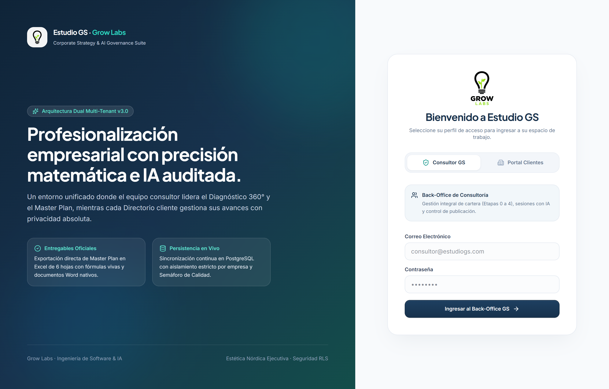
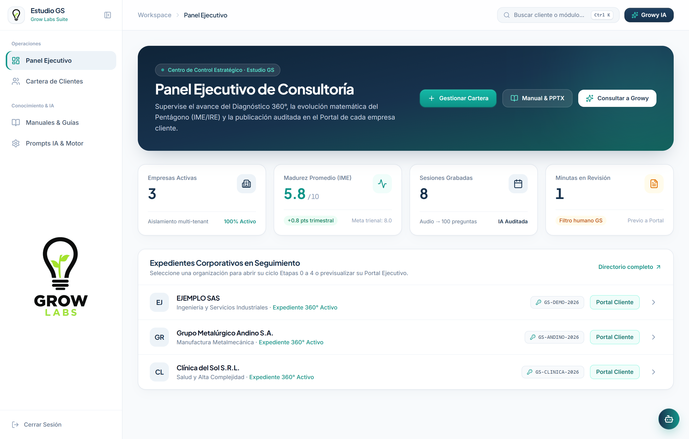
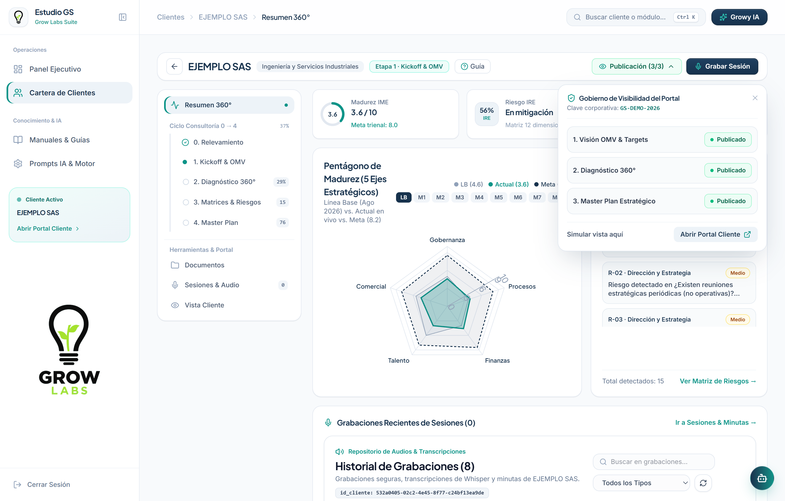
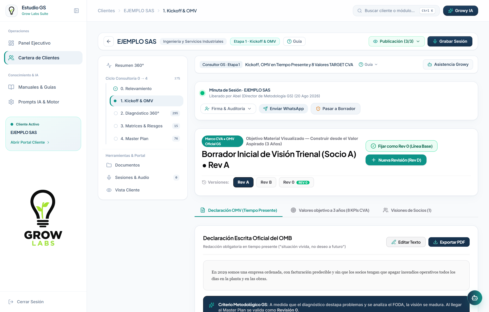
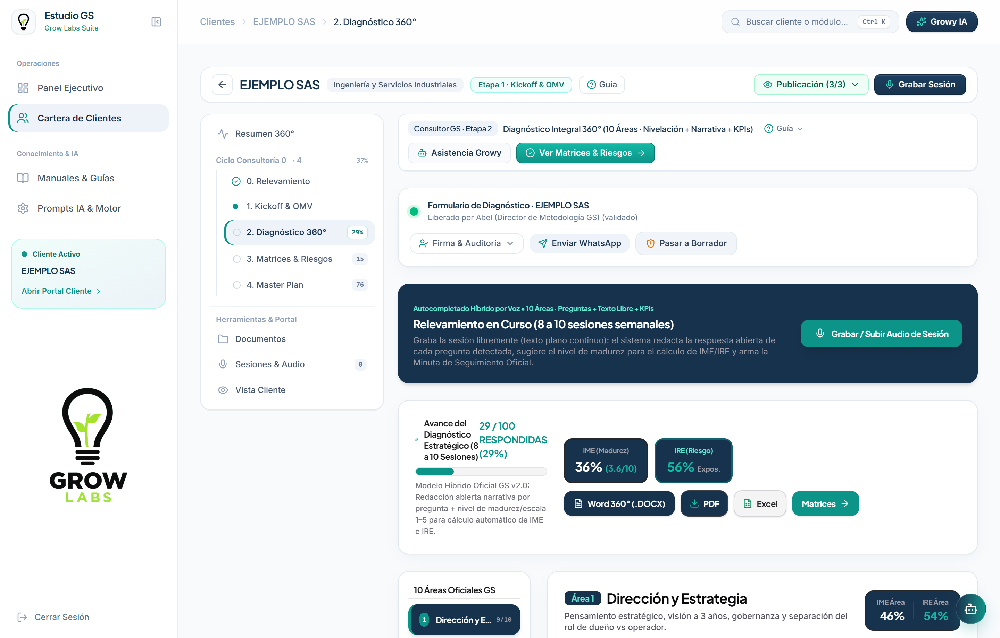
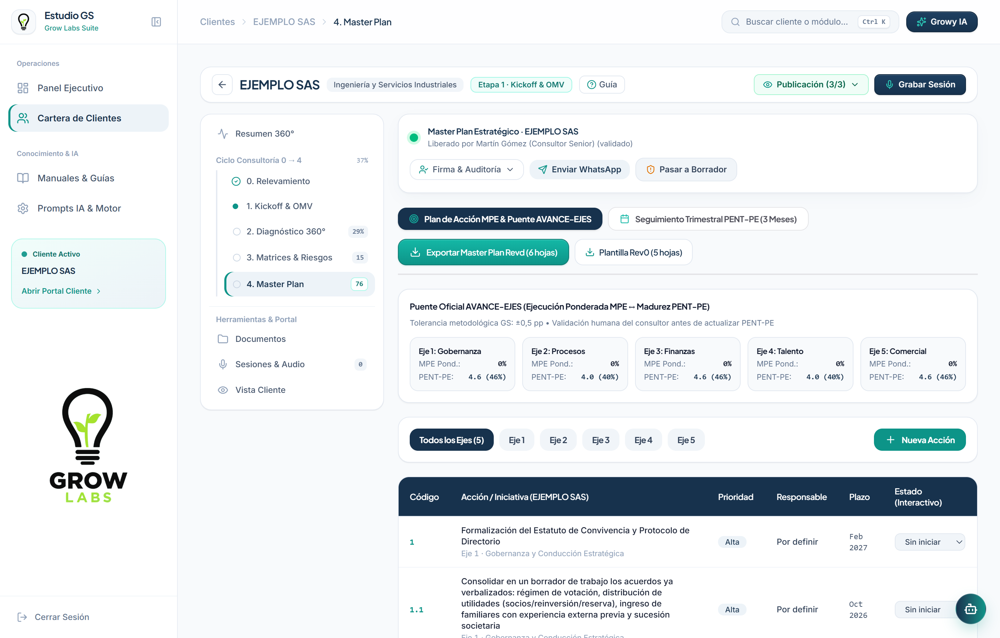
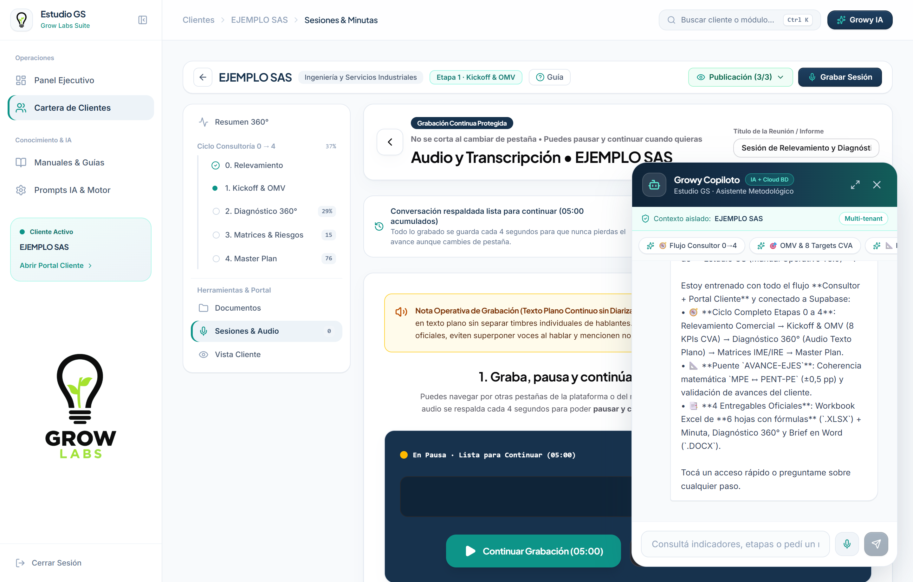
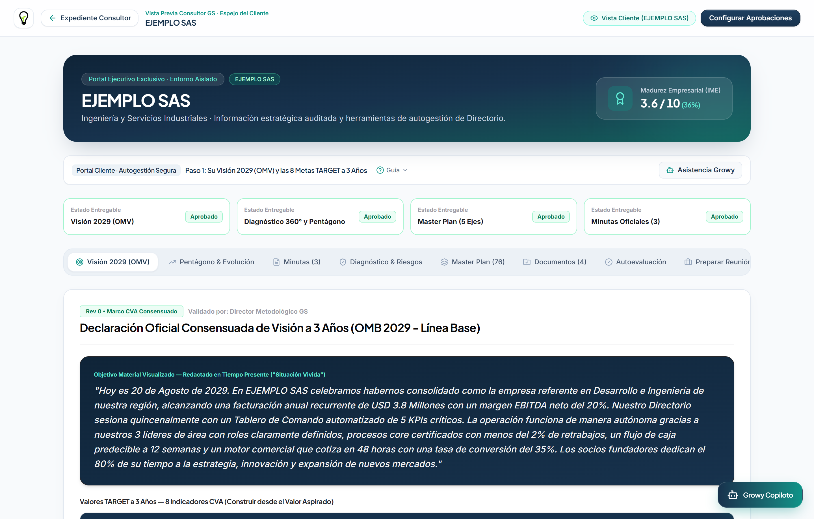
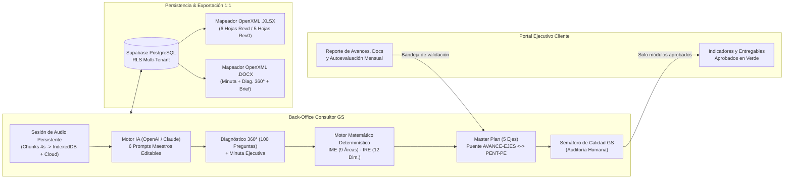

<div align="center">
  

  # Estudio GS · Grow Labs Suite
  ### Plataforma Integral de Consultoría Estratégica, Diagnóstico 360° y Gobernanza con IA Auditada

  <p>
    Ecosistema corporativo <strong>Dual Multi-Tenant</strong> diseñado por <strong>Grow Labs</strong> para profesionalizar empresas combinando rigor matemático (<code>IME</code>, <code>IRE</code>, <code>PENT-PE</code>), captura continua de sesiones con Inteligencia Artificial, entregables nativos 1:1 en Excel/Word y un Portal Ejecutivo aislado para cada Directorio cliente.
  </p>

  <p>
    
    
    
    
    
    
  </p>
</div>

---

## Tabla de Contenidos

1. [Visión General del Sistema](#1-visión-general-del-sistema)
2. [Recorrido Visual: Todo lo que Hace la Plataforma](#2-recorrido-visual-todo-lo-que-hace-la-plataforma)
   - [2.1 Acceso Dual Multi-Tenant (Consultor vs. Cliente)](#21-acceso-dual-multi-tenant-consultor-vs-cliente)
   - [2.2 Panel Ejecutivo de Cartera y Navegación Rápida](#22-panel-ejecutivo-de-cartera-y-navegación-rápida)
   - [2.3 Expediente 360° — Arquitectura A y Gobierno de Publicación](#23-expediente-360-arquitectura-a-y-gobierno-de-publicación)
   - [2.4 Ciclo Metodológico de Consultoría (Etapas 0 a 4)](#24-ciclo-metodológico-de-consultoría-etapas-0-a-4)
   - [2.5 Grabación Continua Protegida + Copiloto Growy IA](#25-grabación-continua-protegida--copiloto-growy-ia)
   - [2.6 Portal Ejecutivo Aislado y Autogestión del Cliente](#26-portal-ejecutivo-aislado-y-autogestión-del-cliente)
3. [Cómo lo Hace: Ingeniería, Arquitectura y Motor Matemático](#3-cómo-lo-hace-ingeniería-arquitectura-y-motor-matemático)
4. [Entregables Corporativos Exportables 1:1 (`.XLSX` y `.DOCX`)](#4-entregables-corporativos-exportables-11-xlsx-y-docx)
5. [Ventajas Estratégicas de Tener Este Sistema](#5-ventajas-estratégicas-de-tener-este-sistema)
6. [Stack Tecnológico y Estructura del Proyecto](#6-stack-tecnológico-y-estructura-del-proyecto)
7. [Instalación y Puesta en Marcha](#7-instalación-y-puesta-en-marcha)

---

## 1. Visión General del Sistema

En la consultoría estratégica tradicional, el conocimiento crítico de cada cliente suele fragmentarse entre decenas de grabaciones sueltas, documentos Word manuales, planillas Excel desconectadas y mensajes de WhatsApp sin trazabilidad.

**Estudio GS · Grow Labs Suite** unifica todo el ciclo de vida de la tutoría empresarial en una única plataforma web de estética nórdica ejecutiva, estructurada sobre **dos entornos estrictamente separados pero sincronizados en tiempo real**:

| Dimensión | Back-Office Consultor Estudio GS | Portal Ejecutivo Empresa Cliente |
| :--- | :--- | :--- |
| **Propósito** | Conducción metodológica integral (Etapas 0 a 4), captura con IA, cálculo matricial y control de calidad. | Visualización ejecutiva de indicadores aprobados y co-gestión ordenada de avances por parte del Directorio. |
| **Alcance de Datos** | Cartera completa de organizaciones clientes. | **Aislamiento multi-tenant estricto**: acceso exclusivo a su propio expediente corporativo. |
| **Etapa 0 Comercial** | Relevamiento inicial, dolores preliminares, código de proyecto y propuesta de honorarios. | **100% invisible** (almacenada bajo clave interna confidencial). |
| **Gobierno de Calidad** | Controla el **Semáforo de Publicación** (`En revisión` vs. `Publicado`) módulo por módulo y minuta por minuta. | Solo accede y descarga los entregables validados y liberados por su consultor líder. |
| **Master Plan** | Diseña los 5 ejes, pondera incidencias, audita el puente `AVANCE-EJES` y **valida avances del cliente**. | Consulta el plan interactivo, descarga su Excel de 6 hojas y **reporta avances con notas de evidencia**. |
| **Copiloto Growy IA** | Modo Consultor (fórmulas, prompts maestros, auditoría técnica, cruces de 100 preguntas). | Modo Cliente Aislado (lectura guiada de OMV, Pentágono, riesgos y preparación de reuniones de Directorio). |

---

## 2. Recorrido Visual: Todo lo que Hace la Plataforma

### 2.1 Acceso Dual Multi-Tenant (Consultor vs. Cliente)

Desde una única portada institucional (`/login`), el sistema distingue el ingreso del **Equipo Consultor GS** (vía credenciales auditadas en Supabase Auth) y el acceso directo al **Portal de Clientes** (mediante correo corporativo o **Código Privado de Portal**, por ejemplo `GS-DEMO-2026`).



---

### 2.2 Panel Ejecutivo de Cartera y Navegación Rápida

Al ingresar al Back-Office, el equipo consultor dispone de una vista consolidada de toda la cartera activa: empresas bajo seguimiento, evolución promedio del **Índice de Madurez Empresarial (`IME`)**, sesiones grabadas, minutas pendientes de revisión humana y un buscador global instantáneo (**Spotlight `Ctrl + K`**) para saltar a cualquier cliente o módulo en milisegundos.



---

### 2.3 Expediente 360° — Arquitectura A y Gobierno de Publicación

Cada organización cuenta con un **Centro de Comando 360°** diseñado bajo una arquitectura **Master-Detail (`Sub-Sidebar Semántico + Popovers`)** que dedica el **88% de la pantalla** a datos e indicadores vivos desde el primer segundo:

- **Cabecera Compacta de Comando**: Identidad del cliente, etapa activa, botón **`? Guía`** con asistencia contextual de Growy IA, disparador directo a **`Grabar Sesión`** y el menú desplegable **`Publicación (3/3)`**.
- **Popover de Visibilidad del Portal en 1 Clic**: Permite alternar instantáneamente qué módulos (`1. Visión OMV & Targets`, `2. Diagnóstico 360°`, `3. Master Plan Estratégico`) están publicados para el cliente o retenidos en revisión interna.
- **Riel Vertical Semántico (`Ciclo Consultoría 0 → 4`)**: Guía secuencial con estados de avance en tiempo real, separada claramente de las herramientas transversales (`Documentos`, `Sesiones & Audio`, `Vista Cliente`).
- **Pentágono de Madurez y Focos Críticos**: Radar comparativo histórico (`Línea Base` vs. `Actual en vivo` vs. `Meta Trienal`) junto con la tarjeta inteligente de *Siguiente acción recomendada* y las vulnerabilidades críticas detectadas.



---

### 2.4 Ciclo Metodológico de Consultoría (Etapas 0 a 4)

La plataforma sistematiza de punta a punta la metodología de **Estudio GS**:

1. **Etapa 0 · Relevamiento Comercial y Propuesta Confidencial**:
   - Asignación del código normado de proyecto (ej. `26-030`), grabación de la entrevista exploratoria inicial, registro de dolores preliminares y estructuración de honorarios. Al aprobarse, habilita con 1 clic el pase formal a Kickoff.
2. **Etapa 1 · Kickoff, Visión OMV en Tiempo Presente y 8 Targets CVA**:
   - Relevamiento individual de las expectativas de cada socio fundador y consolidación asistida por IA.
   - Redacción del **Objetivo Material Visualizado (`OMV`)** estrictamente en **tiempo presente** (*"situación vivida a 3 años"*), control de versiones (`Rev A`, `Rev B`, `Rev 0 Línea Base`) y matriz cuantitativa de los **8 indicadores del marco Construir desde el Valor Aspirado (`CVA`)** (facturación, margen neto, dotación, simultaneidad operativa, mix comercial, reserva financiera, rol de los socios y ventaja competitiva).



3. **Etapa 2 · Diagnóstico Integral 360° (100 Preguntas en 10 Áreas)**:
   - Relevamiento híbrido que combina nivelación estructurada de madurez, **8 preguntas en escala Likert (1–5)**, respuesta narrativa abierta respaldada por citas textuales de las grabaciones y **KPIs cuantitativos específicos por área** (Dirección, Estructura y RRHH, Finanzas, Operaciones, Comercial, Abastecimiento, Tecnología, Calidad, Legal y Contexto).
4. **Etapa 3 · Matrices Estratégicas y Riesgos (`IME` + `IRE`)**:
   - Generación matemática instantánea de **FODA / TOWS**, **PESTEL**, **5 Fuerzas de Porter**, el **Índice de Madurez Empresarial (`IME`, 9 áreas = 100%)** y el **Índice de Riesgo Empresarial (`IRE`, 12 dimensiones = 100% + catálogo de 27 riesgos estratégicos y operativos)**.



5. **Etapa 4 · Master Plan Estratégico (`MPE`), Puente `AVANCE-EJES` y Seguimiento Trimestral**:
   - Plan de acción vivo organizado sobre los **5 Ejes del Pentágono del Orden** (*Gobernanza, Procesos, Finanzas, Talento y Comercial*).
   - Edición directa de la cabecera estratégica de cada eje (**Brecha Asociada**, **Iniciativa Estratégica Rectora** y **OKRs**), que se inyecta automáticamente en el Excel corporativo.
   - **Bandeja de Validación Consultor GS**: Los avances reportados por el cliente desde su portal ingresan en estado pendiente hasta que el consultor los audita y pulsa *"Validar e Impactar"*.



---

### 2.5 Grabación Continua Protegida + Copiloto Growy IA

Uno de los diferenciales operativos más potentes del sistema es su **Motor de Grabación Persistente de Sesiones** acompañado por **Growy Copiloto**:

- **Cero pérdida de audio al navegar o cambiar de pestaña**: El grabador corre como un servicio global independiente del ciclo de renderizado de cada vista. Si el consultor cambia de módulo para consultar el Master Plan o cambia de pestaña en el navegador en plena reunión, la grabación continúa intacta y muestra una barra de control global en la parte superior.
- **Respaldo automático cada 4 segundos + Pausar y Continuar**: Cada fragmento (`chunk`) de audio y texto plano se guarda de inmediato en `IndexedDB`, `localStorage` y `Supabase`. Permite pausar una sesión, cerrarla y **retomar la misma conversación** horas o días después acumulando el tiempo y la transcripción.
- **De Audio a 100 Preguntas + Minuta Oficial en 1 Paso**: Al finalizar la sesión, el motor IA cruza toda la conversación contra el catálogo de **100 preguntas del Diagnóstico 360°**, sugiere respuestas con la **cita textual exacta** del audio y redacta la **Minuta Ejecutiva Oficial** lista para descargar en Word (`.DOCX`) o PDF.
- **Copiloto Metodológico Growy IA**: Asistente contextual conectado en vivo al expediente activo y gobernado desde el **Centro de Prompts IA (`/settings`)**, donde Estudio GS administra los 6 prompts maestros y elige motor (`OpenAI` o `Anthropic Claude`).



---

### 2.6 Portal Ejecutivo Aislado y Autogestión del Cliente

Cada organización cliente dispone de un **Portal Ejecutivo de Directorio** (`/portal/:id`) limpio, intuitivo y blindado:

- **Norte Estratégico e Indicadores Validados**: Consulta su declaración OMV 2029 aprobada, sus 8 metas CVA, la evolución de su Pentágono de Madurez (`IME` / `IRE`) y el repositorio histórico de minutas aprobadas.
- **Co-Gestión Controlada del Master Plan**: El cliente filtra sus iniciativas por eje y reporta el avance porcentual junto con observaciones de respaldo, alimentando la bandeja de revisión de su consultor sin alterar fórmulas ni sobreescribir la línea base sin supervisión.
- **Intercambio Documental, Autoevaluación Mensual y Preparación de Reuniones con IA**: Permite subir estados contables u organigramas directo a su expediente, completar el pulso mensual previo al comité y generar briefs estratégicos en Word (`.DOCX`) para reuniones de Directorio, bancos o clientes clave.



---

## 3. Cómo lo Hace: Ingeniería, Arquitectura y Motor Matemático

### Arquitectura General de Flujo y Seguridad



### Pilares Técnicos Clave

1. **Coherencia Matemática Exacta (`MPE ↔ AVANCE-EJES ↔ PENT-PE`)**:
   A diferencia de tableros meramente subjetivos, la evolución de cada eje del Pentágono se vincula matemáticamente con la ejecución ponderada de las acciones del Master Plan mediante el puente oficial `AVANCE-EJES` (con control de tolerancia metodológica `±0,5 pp`):

   $$\Delta \text{Eje} = (10 - \text{Línea Base}) \times \sum_{i=1}^{n} \left( \text{Incidencia}_i \times \text{Avance}_i \right)$$

2. **Grabación Resiliente desacoplada de React (`src/lib/persistentRecorder.ts`)**:
   Implementa un gestor `Singleton` sobre `MediaRecorder` con particionado continuo cada `4000 ms`, reloj basado en tiempo real (`Date.now()`) inmune al *throttling* de pestañas en segundo plano de Chrome/Edge, volcado inmediato ante eventos `visibilitychange` / `beforeunload` y recuperación automática del flujo de reconocimiento de voz (`src/lib/whisperLiveStream.ts`).

3. **Motor de Inyección OpenXML 1:1 sin Pérdida de Diseño (`JSZip` + DOM XML)**:
   En lugar de generar planillas genéricas planas desde cero que pierden estilos corporativos, los módulos `src/lib/gsTemplateMapper.ts` y `src/lib/gsDocxTemplateMapper.ts` abren los paquetes OpenXML oficiales de Estudio GS (`public/templates/`), clonan dinámicamente la geometría de filas y estilos XML, inyectan los datos reales del cliente, recalculan referencias de fórmulas Excel (`SUMPRODUCT`, `AVERAGE`, `IF`), actualizan el cronograma Gantt y conservan intactos los gráficos Radar nativos de Excel y los encabezados con logo institucional en Word.

4. **IA con Supervisión Humana Obligatoria (*Human-in-the-Loop*)**:
   La IA acelera el trabajo pesado (transcribir, cruzar 100 preguntas con citas textuales, unificar visiones de socios, sugerir matrices y redactar minutas), pero **ningún dato generado por IA llega al Portal del Cliente** sin pasar por la validación explícita del consultor en el Semáforo de Calidad (`QualityApprovalBadge` y Popover de Publicación).

---

## 4. Entregables Corporativos Exportables 1:1 (`.XLSX` y `.DOCX`)

Todos los documentos descargables respetan la nomenclatura, tipografía, paleta institucional y fórmulas vivas de las plantillas oficiales de Estudio GS:

| Entregable Oficial | Formato | Contenido Mapeado Automáticamente |
| :--- | :---: | :--- |
| **Master Plan Estratégico Modelo `Revd`** | `.XLSX` (6 hojas) | `PORTADA` corporativa + `MPE` (62 columnas con `NIVEL`, `INCIDENCIA`, `AVANCE`, `AVANCE PONDERADO DEL EJE`, Brecha, Iniciativa, OKRs y Gantt) + `AVANCE-EJES` + `PENT-PE` con **2 gráficos Radar vivos** + `MATRIZ DE RIESGOS` + `DATOS_PENT`. |
| **Master Plan Estratégico Plantilla `Rev0`** | `.XLSX` (5 hojas) | Línea base inicial de 5 hojas (`PORTADA`, `MPE`, `PENT-PE`, `MATRIZ DE RIESGOS`, `DATOS_PENT`) 100% mapeada al expediente. |
| **Informe Oficial de Diagnóstico 360°** | `.DOCX` | Documento Word completo con encabezado institucional GS, puntajes `IME`/`IRE`, análisis de las 10 áreas, respuestas cualitativas, KPIs y matrices estratégicas. |
| **Minuta Ejecutiva de Seguimiento (`Rev0`)** | `.DOCX` | Resumen ejecutivo de la sesión, hallazgos por área, acuerdos validados y tabla de compromisos con responsables y fechas límite. |
| **Brief Estratégico de Preparación de Reunión** | `.DOCX` | Guía ejecutiva generada con IA para mesas de Directorio, bancos o negociaciones comerciales del cliente. |

---

## 5. Ventajas Estratégicas de Tener Este Sistema

### Comparativa Operativa: Consultoría Tradicional vs. Estudio GS Suite

| Proceso Crítico | Sin el Sistema (Flujo Manual) | Con Estudio GS · Grow Labs Suite |
| :--- | :--- | :--- |
| **Relevamiento de Sesiones** | Horas re-escuchando audios y tomando notas manuales; riesgo de perder la grabación si se cierra o cambia la pestaña. | **Grabación continua blindada cada 4s** + cruce automático contra las 100 preguntas con cita textual y minuta lista en segundos. |
| **Construcción del Master Plan** | Copiar y pegar manualmente entre Word y múltiples hojas Excel, con alto riesgo de romper fórmulas o desfasar el Pentágono. | **Puente matemático `AVANCE-EJES` en vivo** y exportación `.XLSX` de 6 hojas con fórmulas y gráficos Radar intactos en 1 clic. |
| **Relación con el Directorio Cliente** | Envío de archivos estáticos por correo/WhatsApp; el cliente nunca sabe cuál es la última versión vigente. | **Portal Ejecutivo exclusivo 24/7** donde el Directorio ve indicadores al día, descarga versiones oficiales y reporta sus avances. |
| **Confidencialidad y Control** | Riesgo de compartir borradores incompletos o notas comerciales internas por error. | **Blindaje Multi-Tenant + Semáforo de Publicación**: Etapa 0 100% oculta y control granular de qué ve cada cliente. |
| **Escalabilidad del Equipo Consultor** | Cada consultor redacta y pondera con criterios distintos; difícil escalar la cartera sin perder calidad. | **Estandarización metodológica total** (Etapas 0→4 + 6 Prompts Maestros centralizados + trazabilidad de quién redacta y quién aprueba). |

### Impacto Directo de Negocio

- **Ahorro superior al 70% en carga operativa post-reunión**: Lo que antes demandaba entre 3 y 5 horas de procesamiento manual por sesión (desgrabación, minuta, carga de diagnóstico y actualización de planillas) se resuelve en minutos con auditoría humana.
- **Diferenciación competitiva de alto valor percibido**: Entregar a cada PyME o empresa cliente su propio **Portal Ejecutivo con Copiloto IA** eleva radicalmente la experiencia del servicio de consultoría y fideliza contratos de largo plazo.
- **Trazabilidad y activo intelectual propio**: Cada diagnóstico, evolución trimestral, riesgo mitigado y prompt metodológico queda resguardado de forma estructurada en base de datos relacional para toda la firma.

---

## 6. Stack Tecnológico y Estructura del Proyecto

- **Frontend & UI**: React 19, TypeScript 6, Vite 8, Tailwind CSS 4 (estética clínica y nórdica ejecutiva), Lucide Icons, Recharts (gráficos Radar y evolución), Mermaid (mapas conceptuales dinámicos).
- **Backend, Auth & Persistencia**: Supabase (`PostgreSQL`, `Supabase Auth`, `Edge Functions` para transcripción y despacho WhatsApp, sincronización híbrida Cloud + `IndexedDB` para resiliencia offline).
- **Motores Documentales**: `JSZip` + manipulación directa de árboles OpenXML (`.xlsx` / `.docx`), `docx`, `xlsx`, `jsPDF` + `jspdf-autotable`.

```text
gs/
├── public/
│   ├── grow-favicon.png                 # Isotipo Grow Labs (pestaña y cabeceras)
│   ├── grow-logo-clean.png              # Identidad vertical transparente Grow Labs
│   └── templates/                       # Plantillas corporativas oficiales OpenXML (.xlsx / .docx)
├── docs/
│   └── screenshots/                     # Capturas en alta resolución de los módulos del sistema
├── src/
│   ├── components/
│   │   ├── Layout.tsx                   # Shell principal, Sidebar Grow Labs, Spotlight Ctrl+K y barra de audio global
│   │   ├── GrowyChat.tsx                # Copiloto IA contextual (Modo Consultor y Modo Cliente aislado)
│   │   ├── QualityApprovalBadge.tsx     # Firma de auditoría y trazabilidad de calidad GS
│   │   └── views/                       # Módulos Etapas 0→4, Grabador de Sesiones, Matrices y Portal Cliente
│   ├── data/                            # Catálogo de 100 preguntas, 5 ejes MPE, metadatos estratégicos y riesgos
│   ├── lib/
│   │   ├── diagnosticEngine.ts          # Motor matemático determinístico (IME, IRE, FODA, PESTEL, Porter)
│   │   ├── persistentRecorder.ts        # Grabador continuo en segundo plano (chunks 4s -> IndexedDB + Supabase)
│   │   ├── gsTemplateMapper.ts          # Exportador 1:1 OpenXML para Master Plan Excel (Revd 6 hojas / Rev0 5 hojas)
│   │   ├── gsDocxTemplateMapper.ts      # Exportador 1:1 OpenXML para Minuta y Diagnóstico 360° en Word
│   │   └── gsCloudSync.ts               # Sincronización multi-tenant con PostgreSQL (Supabase)
│   └── pages/
│       ├── Login.tsx                    # Acceso dual Consultor GS / Portal Clientes
│       ├── Dashboard.tsx                # Panel Ejecutivo de cartera
│       ├── ClientDetail.tsx             # Expediente 360° (Arquitectura A: Sub-Sidebar + Popovers)
│       ├── ClientPortalPage.tsx         # Portal Ejecutivo aislado por organización
│       ├── KnowledgeBase.tsx            # Manuales operativos interactivos y presentación ejecutiva
│       └── SettingsPrompts.tsx          # Gobierno de los 6 Prompts Maestros y selección de motor IA
└── MANUAL_OPERATIVO_GS.md               # Guía operativa detallada para Consultores y Clientes
```

---

## 7. Instalación y Puesta en Marcha

### Requisitos Previos
- **Node.js** `>= 20.x` y `npm`
- Proyecto activo en **Supabase** (PostgreSQL + Auth)

### Pasos de Instalación

1. **Clonar el repositorio e instalar dependencias**:
   ```bash
   git clone https://github.com/lucasmmg12/gs.git
   cd gs
   npm install
   ```

2. **Configurar las variables de entorno**:
   Crear un archivo `.env` en la raíz del proyecto con las credenciales de Supabase:
   ```env
   VITE_SUPABASE_URL=https://tu-proyecto.supabase.co
   VITE_SUPABASE_ANON_KEY=tu_clave_anon_publica
   ```

3. **Iniciar el servidor de desarrollo**:
   ```bash
   npm run dev
   ```

4. **Compilar para producción (verificación estricta TypeScript + bundle Vite)**:
   ```bash
   npm run build
   ```

---

<div align="center">
  <sub>Desarrollado por <strong>Grow Labs · Ingeniería de Software & IA</strong> para <strong>Estudio GS Consultora</strong>.</sub>
</div>
