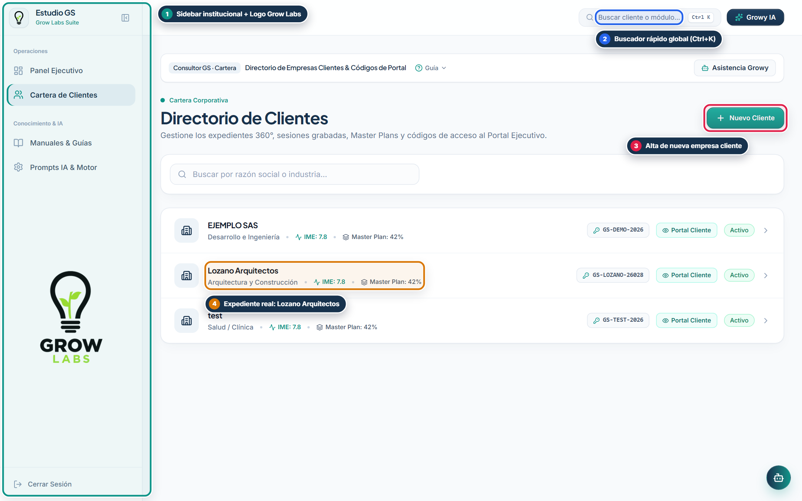
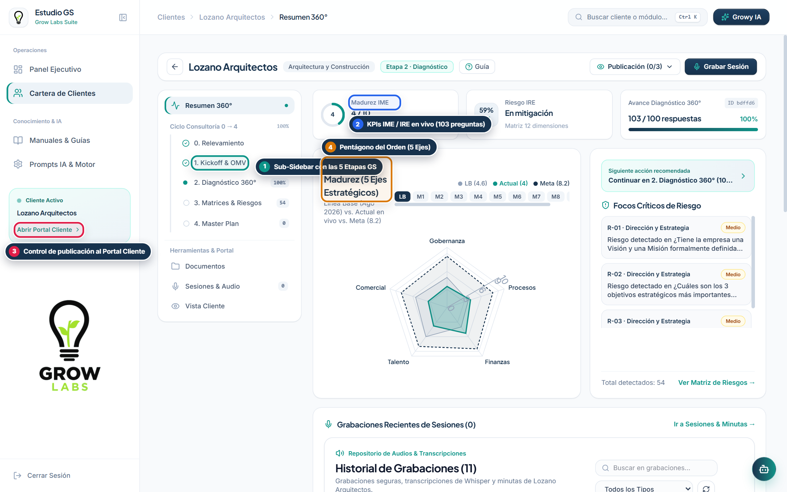
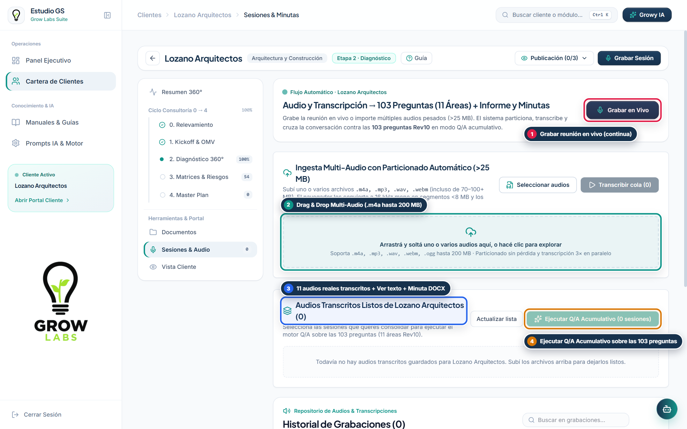
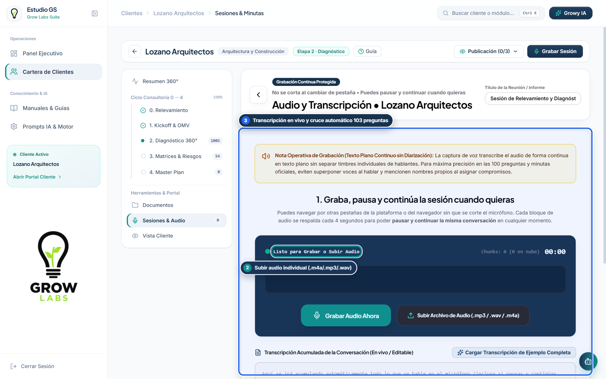
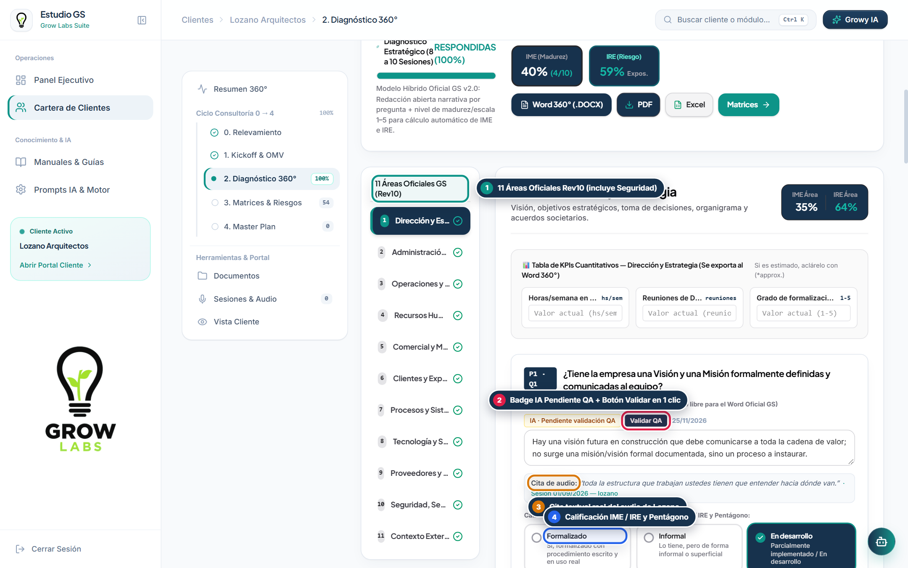
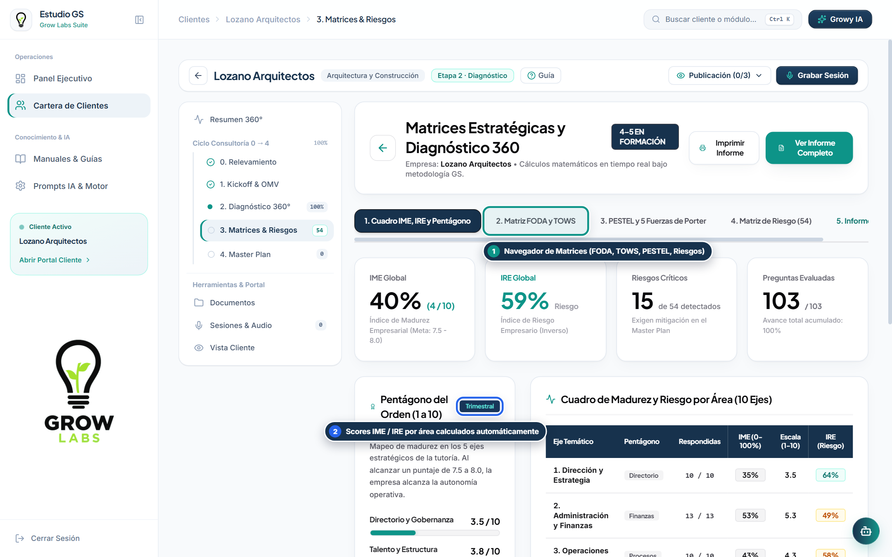
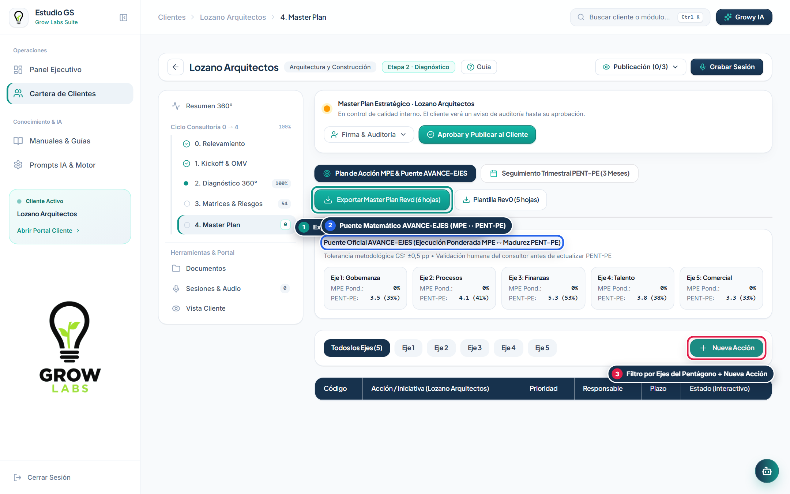

# Tutorial Visual Paso a Paso — Estudio GS · Grow Labs Suite

Guía práctica con **capturas reales señalizadas** (utilizando el expediente real de **Lozano Arquitectos · Proyecto `26-028`**) para operar de punta a punta cualquier cliente en la plataforma, tanto **grabando reuniones en vivo** como **ingresando audios pregrabados pesados (`.m4a`, `.mp3`, `.wav`)**.

---

## Paso 1 · Cartera de Clientes y Alta de Nueva Empresa

Desde la pantalla principal de **Cartera de Clientes** (`/clients`) gestionás todos los expedientes aislados (multi-tenant) de la consultora.

- **① Sidebar institucional + Logo Grow Labs**: Navegación principal colapsable entre *Panel Ejecutivo*, *Cartera de Clientes*, *Manuales & Guías* y *Prompts IA & Motor*.
- **② Buscador rápido global (`Ctrl+K`)**: Permite saltar en 1 segundo a cualquier empresa o módulo sin navegar menú por menú.
- **③ Nuevo Cliente**: Da de alta una nueva organización con su rubro, código de proyecto (ej. `26-028`) y código de acceso privado al Portal Cliente.
- **④ Expediente del Cliente**: Hacé clic sobre **Lozano Arquitectos** (o cualquier empresa) para ingresar a su Expediente 360° aislado.

---

## Paso 2 · Navegación del Expediente 360° (Arquitectura A)

Al abrir un cliente, accedés a su espacio de trabajo integral organizado en las **5 etapas del Círculo Virtuoso de la Acción (CVA)**.

- **① Sub-Sidebar de Etapas GS**: Recorre en orden secuencial: *0. Relevamiento*, *1. Kickoff & OMV*, *2. Diagnóstico 360°*, *3. Matrices & Riesgos*, *4. Master Plan*, además de *Sesiones & Minutas*, *Documentos* y *Vista Previa Portal*.
- **② Indicadores IME / IRE en vivo**: Reflejan automáticamente la madurez empresaria (0–100% / 0–10) y el nivel de exposición al riesgo calculados sobre las **103 preguntas Rev10**.
- **③ Control de publicación al Portal Cliente (Semáforo Rojo / Verde)**: Nada se muestra al cliente hasta que el consultor aprueba y publica cada entregable en Verde.
- **④ Pentágono del Orden (5 Ejes)**: Radar comparativo en tiempo real entre Línea Base, Estado Actual y Meta 2029.

---

## Paso 3 · Sesiones, Grabación en Vivo e Ingesta Multi-Audio (>25 MB)

Ingresá a **Sesiones & Minutas** (`/clients/:id/meetings`) para trabajar con los audios del cliente por cualquiera de las dos vías: **grabar en vivo** o **subir grabaciones previas**.

- **① Grabar en Vivo**: Abre el estudio de grabación continua protegida (ideal para reuniones presenciales o por videollamada).
- **② Zona Drag & Drop Multi-Audio (hasta 200 MB por archivo)**: Arrastrá y soltá uno o varios archivos `.m4a`, `.mp3`, `.wav`, `.webm` o `.ogg` (como los 11 audios de 70–98 MB de Lozano).
  - El sistema los **particiona automáticamente sin pérdida** en el navegador en segmentos `< 7 MB` y los transcribe **3× en paralelo** directo en Supabase, sin límites de 25 MB y sin inventar datos si hay un error de red.
- **③ Audios Transcritos Listos**: Cada sesión queda guardada en base de datos con su duración y cantidad de caracteres. Desde cada tarjeta podés:
  - **Ver / Editar texto**: Abre la transcripción completa para revisar o corregir nombres propios.
  - **Minuta (`.DOCX`)**: Genera y descarga al instante la Minuta Oficial en Word con el formato institucional GS.
- **④ Ejecutar Q/A Acumulativo**: Tildá 1 o todas las sesiones del cliente y presioná este botón. El motor `gpt-5.5` cruza automáticamente toda la conversación en bloques seguros (sin timeouts) contra las **103 preguntas de las 11 áreas**, agrupando citas textuales por origen y abriendo la **Bandeja de Revisión QA Humana** antes de impactar el diagnóstico.

---

## Paso 4 · Estudio de Grabación Continua en Vivo

Si estás en reunión con el cliente y querés grabar directo desde la plataforma:

- **① Iniciar / Pausar Grabación Continua**: Mantiene la captura activa incluso si cambiás de pestaña o bloqueás la pantalla (respaldo local en IndexedDB + subida en chunks a Supabase Storage).
- **② Subir Audio Individual**: Alternativa rápida para importar un único archivo `.m4a`/`.mp3`/`.wav` dentro de la misma sesión.
- **③ Transcripción en Vivo y Cruce Automático**: Al finalizar la sesión, el sistema cruza el texto contra las **103 preguntas Rev10** y redacta el borrador de **Minuta Ejecutiva** listo para auditar.

---

## Paso 5 · Diagnóstico Integral 360° (11 Áreas · 103 Preguntas Rev10 + QA)

En **2. Diagnóstico 360°** (`/clients/:id/diagnostic`) encontrás el formulario completo precargado con todas las respuestas extraídas de los audios del cliente.

- **① Navegador de las 11 Áreas Oficiales Rev10**: Incluye las 10 áreas internas ponderadas (sumando 100% del IME, incluyendo el **Área 10 · Seguridad, Seguros y Gestión de Riesgos**) más el **Área 11 · Contexto Externo (PESTEL)**.
- **② Badge `IA · Pendiente validación QA` + Botón `Validar QA`**: Identifica al instante qué respuestas fueron completadas automáticamente desde los audios. Al pulsar **Validar QA**, la respuesta queda blindada como `Validado por consultor` (ninguna corrida futura de audios podrá sobrescribirla).
- **③ Cita Verbatim de Audio**: Debajo de cada cuadro de texto editable se muestra la **cita textual exacta** dicha por los socios y el nombre de la sesión de origen para auditoría inmediata.
- **④ Calificación IME / IRE y Pentágono**: Permite ajustar el nivel de madurez/escala 1–5 que alimenta en tiempo real el IME, el IRE y el Word Oficial (`.DOCX`).

---

## Paso 6 · Matrices Estratégicas (Pentágono, FODA, TOWS, PESTEL y Riesgos IRE)

En **3. Matrices & Riesgos** (`/clients/:id/matrices`), todo se calcula automáticamente en función de las respuestas validadas en el Diagnóstico 360°.

- **① Selector de Matrices**: Alterná entre **FODA Automático**, **Estrategias TOWS (FO/DO/FA/DA)**, **PESTEL** y **Matriz de Riesgos (13 dimensiones IRE, incluyendo R13 · Seguridad, siniestralidad y coberturas)**.
- **② Scores IME / IRE por Área**: Desglose numérico y semáforo por cada una de las 11 áreas.
- **③ Hallazgos Trazables**: Cada fortaleza, debilidad o riesgo crítico apunta al código exacto de pregunta (`Q1..Q103`) que lo originó.

---

## Paso 7 · Master Plan Estratégico y Exportadores Excel Oficiales (6 Hojas)

En **4. Master Plan** (`/clients/:id/master-plan`) transformás el diagnóstico en un plan de acción ejecutable organizado en los **5 Ejes del Pentágono del Orden**.

- **① Exportadores 1:1 OpenXML**:
  - **Exportar Master Plan Revd (6 hojas)**: Genera el libro Excel oficial (`PORTADA`, `MPE`, `AVANCE-EJES`, `PENT-PE`, `MATRIZ DE RIESGOS`, `DATOS_PENT`) con fórmulas vivas, ponderación de incidencia y gráficos Radar/Gantt preservados.
  - **Plantilla Rev0 (5 hojas)**: Versión inicial de arranque del proyecto.
- **② Puente Matemático `AVANCE-EJES` en vivo**: Conecta el % de avance ponderado de las tareas del Master Plan con la evolución proyectada del Pentágono (`PENT-PE`).
- **③ Filtro por Ejes + Gestión de Acciones**: Creá nuevas acciones, asigná responsables y plazos, y validá los avances que el cliente reporta desde su **Portal Ejecutivo Aislado**.

---

## Flujo Recomendado para Llevar un Cliente Real (Resumen Operativo)

1. **Crear empresa** en *Cartera de Clientes* (ej. `Lozano Arquitectos · 26-028`).
2. **Capturar sesiones**:
   - *En reunión*: usar **Grabar en Vivo** (soporta reuniones de 2+ horas sin cortes).
   - *Con grabaciones previas*: arrastrar todos los `.m4a` en **Ingesta Multi-Audio** → esperar transcripción 3× en paralelo → descargar **Minuta (`.DOCX`)** de cada reunión.
3. **Ejecutar Q/A Acumulativo**: cruzar todas las transcripciones contra las **103 preguntas Rev10** y aprobar/editar en la **Bandeja QA**.
4. **Auditar en Diagnóstico 360°**: revisar citas verbatim, completar KPIs numéricos y pulsar **Validar QA** en las respuestas clave.
5. **Revisar Matrices + Construir Master Plan**: ajustar iniciativas por eje, exportar **Word 360°** y **Excel Revd (6 hojas)**, y pasar el semáforo a **Verde** para habilitar el Portal del Cliente.
